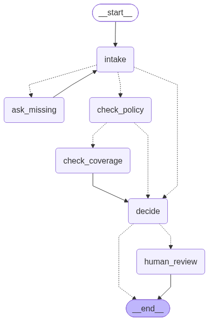

# Claims-handling agent – mobile device insurance

A LangGraph `StateGraph` agent that handles damage claims for a fictional insurer of phones and laptops.
It is a fixed flow with an explicit state (`ClaimState`). Everything is in [main.py](main.py).

## Graph



Dotted edges are conditional:
- `intake` → `ask_missing` if data is missing, → `check_policy` if the claim is complete, → `decide` if data is still missing after 3 rounds.
- `check_policy` → `check_coverage` if the policy is valid, → `decide` on a policy error.
- `decide` → `__end__` on APPROVED / REJECTED, → `human_review` on ESCALATION.

The image is generated from the compiled graph with `python main.py mermaid`.

| Node | What it does | LLM? |
|---|---|---|
| `intake` | Extracts policy number, device, date, damage type and amount (Pydantic structured output). Each value is then checked against the claim text so the model can't make up a policy number, date, amount or brand. | yes |
| `ask_missing` | `interrupt()` asks the user for the missing fields (Article 11), then goes back to `intake`. | – |
| `check_policy` | The `check_policy_tool` tool over `policies.json` checks that the policy exists, its status (Art. 12), the coverage period (Art. 2), which device is insured (Art. 1), and the limit, deductible and device age. | – |
| `check_coverage` | RAG: BM25 retrieval over the coverage articles of [terms.md](terms.md) (Art. 3–6), then the LLM decides and cites an article. The cited article must be one of the retrieved ones. | yes |
| `decide` | Deterministic decision and payout: `min(claimed, depreciated value, limit) − deductible`, with depreciation of 20 %/year capped at 60 % (Art. 7–9). Escalates if the amount is > €800 or the incident happened < 30 days after the policy start (Art. 10). | – |
| `human_review` | `interrupt()` (checkpointer `MemorySaver`). The assessor approves or rejects in the CLI, then the graph resumes. | – |

Every decision comes with a reason that cites an article of the terms.

## Files

[terms.md](terms.md) and [policies.json](policies.json) are synthetic data made for this task. The insurer, the policyholders and the policies are fictional.

- [terms.md](terms.md) – insurance terms (12 articles)
- [policies.json](policies.json) – 5 policies
- [claims/](claims/) – `C01–C10` provided test claims, `X01–X05` custom cases (X01–X03 adversarial: prompt injection, intentional damage passed off as an accident, theft without a police report; X04 is the exact €800 boundary, X05 a non-existent policy). Each file holds the expected outcome.
- [eval_results.md](eval_results.md) – latest evaluation results

## Running

To run the code, you first need to install the dependencies listed in [requirements.txt](requirements.txt).

```bash
ollama pull llama3.2               # local model (default)

python main.py                     # interactive CLI
python main.py eval                # evaluation over claims/ -> eval_results.md
python main.py mermaid             # graph diagram -> agent_graph.png

python main.py eval --remote       # Claude instead of llama3.2
```

For `--remote`, put `ANTHROPIC_API_KEY=...` in a `.env` file.

Dates in claims are accepted as `2026-08-03`, `3 August 2026`, `August 3, 2026` or `3/8/2026` (day first). Amounts as `€250`, `250 €`, `250 EUR` or `1,500 euros`.

## Evaluation

`python main.py eval` runs all 15 cases. Interrupts are answered automatically. The follow-up answers come from the claim file and the assessor's decision comes from `expected.assessor_decision`. For escalated cases, the scored decision is `ESCALATION` (the system's decision before human review). The payout is scored after the assessor approves.

Result with `ollama:llama3.2` (full table in [eval_results.md](eval_results.md)):

| Metric | Result |
|---|---|
| Decision accuracy | 15/15 (100 %) |
| Payout correctness | 15/15 (100 %) |
| Cited article correctness | 15/15 (100 %) |

An earlier version of the project used Slovenian terms and claims. The same pipeline scored 12/15 on all three metrics, and every miss (C04, C06, X02) was in the coverage step. After the terms and claims were translated to English, those cases pass. This is because the 3B model seems to reason about the coverage articles much better in English than in Slovenian.

Only `ollama:llama3.2` has been evaluated. No remote LLM tokens were available, so the `--remote` path is implemented but has not been tested.

### Where the system is weak and why

- **Article 5 depends on the LLM's reasoning.** Theft is covered only with a break-in *and* a police report, so this is the one article where the verdict depends on the model weighing conditions. C04 and C06 failed here with Slovenian input. Extracting these facts as booleans (`break_in`, `police_report`) would let code decide instead.
- **A wrong citation leads to a wrong verdict.** For articles that only grant cover (3, 4) or only exclude it (6), the cited article fixes the verdict, so if the model cites the wrong one, the decision is wrong too.
- **Retrieval depends on the damage type from intake.** In X02 the claimant threw the phone in anger but asks for it to be reported as a drop. It passes only because intake classifies it as `intentional_damage`. As `physical_damage`, the exclusions article (Art. 6) isn't retrieved and the claim would most likely be approved.
